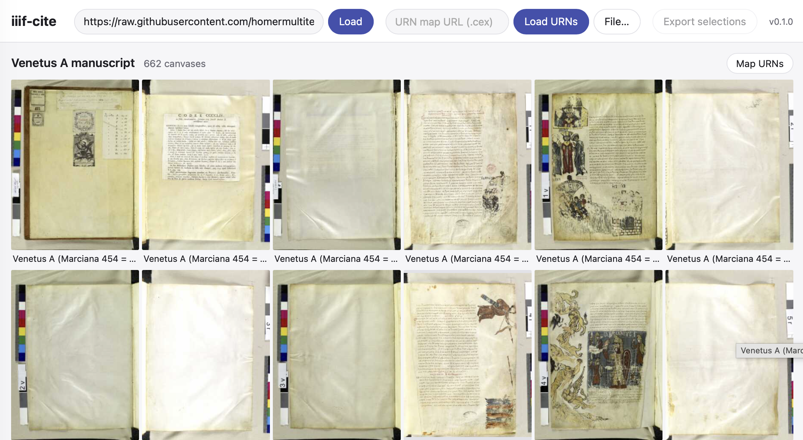
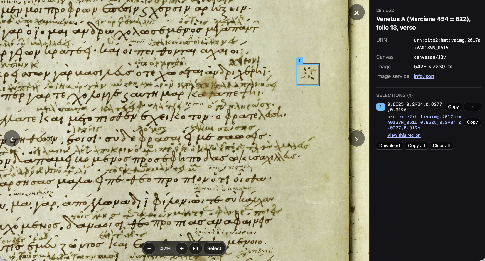

#    iiif-cite 

Browse and cite images from collections published in IIIF manifests or plain-text catalogs.

- [documentation](https://neelsmith.github.io/iiif-cite/) 
-  example installation of [current version](https://neelsmith.github.io/iiif-cite/iiif-cite.html) hosted on github pages

### Browse IIIF manifests

### Cite with URNs

Configure for URN citation and define regions of interest:

### Live examples

A working installation:  [https://neelsmith.github.io/iiif-cite/iiif-cite.html](https://neelsmith.github.io/iiif-cite/iiif-cite.html)

With preloaded manifests:

- [*Io. Friderici Weidleri Historia Astronomiae*](https://neelsmith.github.io/iiif-cite/iiif-cite.html#manifest=https://manifests.sub.uni-goettingen.de/iiif/presentation/PPN623133725/manifest) (manifest provided by [Universität Göttingen](https://manifests.sub.uni-goettingen.de/iiif/presentation/PPN623133725/manifest))
- [Venetus A manuscript](https://neelsmith.github.io/iiif-cite/iiif-cite.html#manifest=https://raw.githubusercontent.com/homermultitext/hmt-archive/refs/heads/master/iiif/venetusA.json) (manifest provided by the [Homer Multitext project](https://raw.githubusercontent.com/homermultitext/hmt-archive/refs/heads/master/iiif/venetusA.json))

With preloaded manifest + URN map for canonical citation:

- [Complutensian Bible from Spanish National Library, volume 1](https://neelsmith.github.io/iiif-cite/iiif-cite.html#manifest=https://raw.githubusercontent.com/neelsmith/complutensian-texts/refs/heads/main/iiif/complutensian-bne-v1-manifest.json&urns=https://raw.githubusercontent.com/neelsmith/complutensian-texts/refs/heads/main/iiif/complutensian-bne-vol1-urns.cex)

Direct link to a page with multiple URN parameters:

- Complutensian Bible, vol. 1, [quire a, page 1 recto, Greek, Hebrew and lemmatizing notes](https://neelsmith.github.io/iiif-cite/iiif-cite.html?manifest=https://raw.githubusercontent.com/neelsmith/complutensian-texts/refs/heads/main/iiif/complutensian-bne-v1-manifest.json&urns=https://raw.githubusercontent.com/neelsmith/complutensian-texts/refs/heads/main/iiif/complutensian-bne-vol1-urns.cex&urn=urn:cite2:citebne:complutensian1.v1:v1p19@0.8467,0.0834,0.0431,0.0170&urn=urn:cite2:citebne:complutensian1.v1:v1p19@0.6861,0.0699,0.1059,0.0215&urn=urn:cite2:citebne:complutensian1.v1:v1p19@0.3869,0.0679,0.0597,0.0140) indexed with `a`
