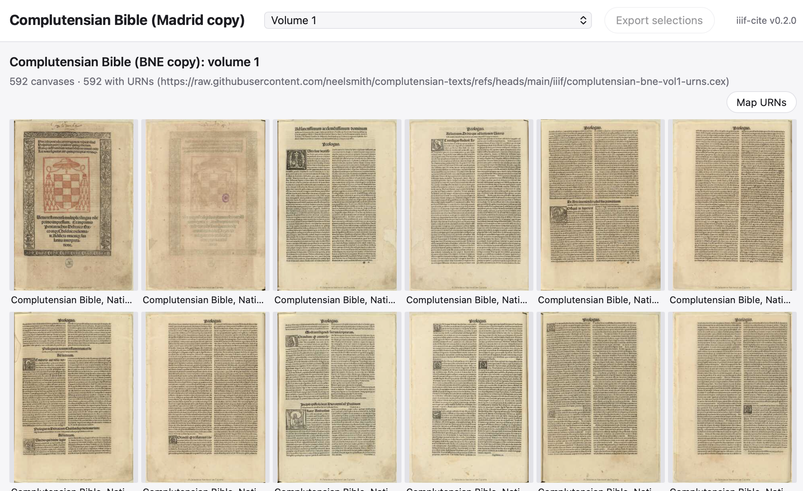

::: {.callout-note}
## Prerequisites
You'll need `npm` on your system. The first time you use the package's `npm` commands, you'll need to download all prerequisites by running `npm install` before trying to use of the package's other `npm` commands.
:::

You can easily package a preconfigured app to create an image browsing and citation tool for your project. There are two steps:

1. define data collections to include in a JSON file that names a title, a list of one or more collections, and a default collection to open from 
2. use `npm run package` to create a named app from the configuration file


## Configuring data collections


The heart of the JSON configuration for a project is the list of collections. For a IIIF source, this comprises a label, a URL for the manifest, and a URL for URN map data.
This is a complete configuration:

```json
{ 
    "title": "Complutensian Bible (Madrid copy)",
    "collections": [ 
        { 
            "label": "Volume 1", 
            "manifest": "https://raw.githubusercontent.com/neelsmith/complutensian-texts/refs/heads/main/iiif/complutensian-bne-v1-manifest.json",
            "urns": "https://raw.githubusercontent.com/neelsmith/complutensian-texts/refs/heads/main/iiif/complutensian-bne-vol1-urns.cex" 
        }
    ],
    "default": "Volume 1" 
}
```


 For a collection of simple files with a plain-text catalog, include a URL for the catalog, and `true` if the files have thumbnails, or `false` if they do not.


```
{
  "title": "Pliny the Elder",
  "collections": [
    {
        "label": "Leiden, Lipsisus 7",
        "catalog": "https://shot.holycross.edu/images/mss/lipsius7/lips7.cex",
        "thumbnails": true
    }
]
}
```


::: {.callout-tip}
You can find examples of configured projects in the github repository's [`projects` directory](https://github.com/neelsmith/iiif-cite/tree/main/projects).
:::

## Build


First build a current version of `iiif-cite.html`


```
cd src
npm run build
```

This example builds an app from a JSON file in this repository's `projects` directory (`../projects/complutensian.json` from the perspective of the `src` directory). Use this syntax:

```
npm run package -- ../projects/complutensian.json        
```

## Result

The result is written to `dist/complutensian.html`. Opening it in a browser looks like this:



In lieu of the text inputs for manifest and URN map, there is a menu of citable manifests, open to the default collection.
