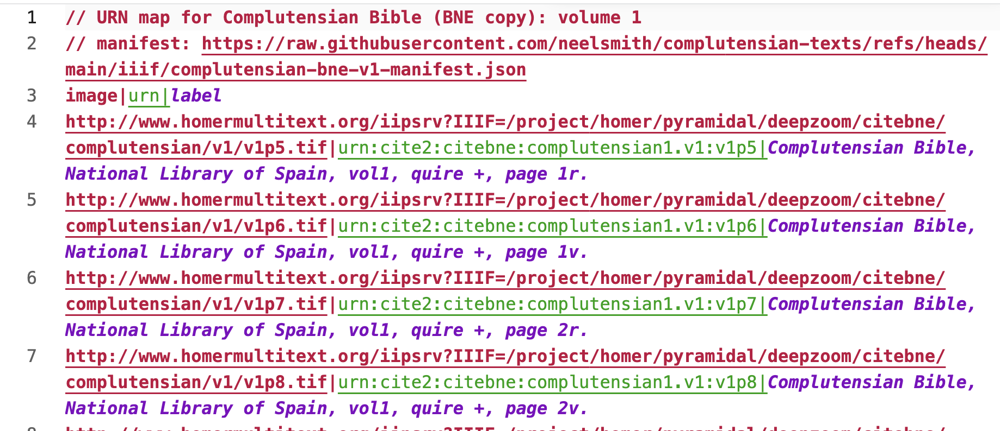
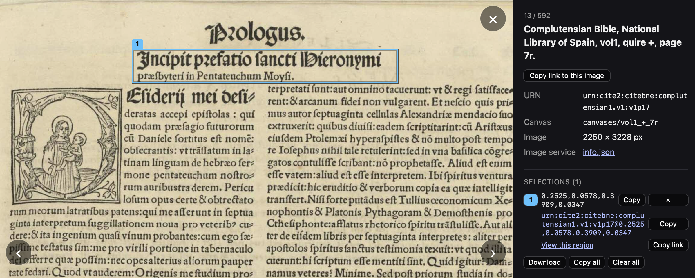

::: {.callout-caution}
## Documentation TBA
:::

## Map image IDs to URNs

## Save the map as a delimited-text file

Choose "Download map". The resulting text file will look like this.

## Use the new URN map

Add the local file as the URN map, or post it to the web and add and add it from a URL. Now when you cite regions of interest, they are expressed as URNs.

